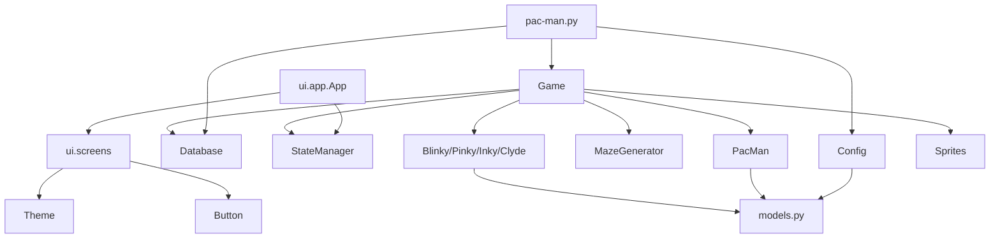

*This project has been created as part of the 42 curriculum by tlogtenb, asylla.*

# Pac-Man

## Description

Pac-Man is a complete, playable recreation of the 1980 Namco arcade
classic, written in Python with pygame. The player guides Pac-Man
through procedurally generated mazes, eats every pacgum, avoids four
ghosts, and collects power pellets to turn the tables on them. The
project includes a main menu, an in-game HUD, pause and death overlays,
a persistent top-ten leaderboard, a configurable scoring system, a cheat
mode for testing, and a PyInstaller packaging recipe for desktop
distribution.

The mazes are generated by the A-Maze-Ing `mazegenerator` package,
version 2.0.2, installed from the wheel in `maze/`. The game reads the
generator's wall bitmasks directly and owns rendering, collision, ghost
AI, scoring and progression.

## Features

- Main menu with start, highscores, instructions and exit.
- Ten levels by default, each with a configurable time limit.
- First level generated from the configured fixed seed, later levels
  generated with fresh random seeds.
- Four ghosts with classic-inspired targets: Blinky chases directly,
  Pinky aims ahead of Pac-Man, Inky uses Blinky as a pivot, and Clyde
  retreats when he gets too close.
- Frightened ghosts flee to their corners, slow down, and can be eaten.
- Eaten ghosts return to their corner as eyes and respawn after five
  seconds.
- Persistent SQLite highscores with a strict top-ten limit.
- Configurable JSON file with comments, defaults and clamping.
- Full cheat mode for testing and demonstrations.
- One-file executable packaging with PyInstaller and a GitHub Actions
  build matrix for Linux, Windows and macOS.

## Instructions

### Requirements

- Python 3.10 or newer.
- `uv` (recommended) or `pip`.
- A graphical desktop session. The game uses pygame, SDL 2 and SVG
  sprites.

### Install and run from the repository

```sh
make install
make run
```

`make install` uses `uv sync --all-groups` when `uv` is available and
falls back to a local `.venv` with `pip` otherwise.

Launch the game with exactly one argument, the configuration file:

```sh
python3 pac-man.py config.json
```

`make run` uses that exact form. A missing or extra argument prints a
clear usage message and exits without a Python traceback. A missing or
invalid configuration file prints a warning and continues with the
documented defaults.

### Other Makefile rules

```sh
make debug          # run the game under Python's built-in pdb
make lint           # flake8 and mypy checks
make lint-strict    # flake8 . and mypy --strict
make test           # headless pytest suite
make clean          # remove caches and build artifacts
make package        # build the PyInstaller executable
```

### Packaging

```sh
make package
```

The output is written to `dist/`. The recipe is `42-pacman.spec` at the
repository root. Linux and Windows produce a single executable. macOS
produces a `.app` bundle. `make package` also copies `config.json` and
this README next to the build so the package contains its own
configuration and instructions.

The GitHub Actions workflow in `.github/workflows/build.yml` builds the
same package on Linux, Windows and macOS. Packaged builds read
`config.json` from the executable directory (or from the bundle), and
store highscores in the platform user-data directory:

- Linux: `$XDG_DATA_HOME/42-pacman/` or `~/.local/share/42-pacman/`
- Windows: `%APPDATA%\42-pacman\`
- macOS: `~/Library/Application Support/42-pacman/`

Release builds are produced with `make package` and the CI workflow. The
package can be published as an unlisted itch.io project;
`project_management/deployment.md` contains the upload checklist.

## Controls

| Context | Key | Action |
| --- | --- | --- |
| Menus | Up / Down or W / S | Move selection |
| Menus | Enter / Space / mouse | Confirm |
| Menus | Escape | Back or return to the main menu |
| Game | Arrow keys or WASD | Move Pac-Man |
| Game | P or Escape | Pause and resume |
| Game | Q | Quit the application |
| Name entry | A-Z, 0-9, space | Enter a name, maximum 10 characters |
| Name entry | Backspace | Delete the last character |
| Name entry | Enter | Save the score |
| Name entry | Escape | Skip saving |

## Cheat Mode

Cheats are built for quick testing and demonstrations.

1. On the main menu, enter the Konami code:
   `Up Up Down Down Left Right Left Right A B`.
2. The title turns rainbow-coloured and `CHEATS ACTIVE` appears.
3. During a game, use these keys:

| Key | Cheat |
| --- | --- |
| `1` | Toggle invincibility. Ghosts cannot take a life and the level timer cannot kill Pac-Man. |
| `2` | Toggle a three-times player speed boost. |
| `3` | Toggle ghost freeze. Released and future ghosts stay still. |
| `4` | Add one extra life, up to the safe maximum. |
| `5` | Skip the current level immediately. On the final level this wins the game. |

The cheat hotkeys also activate cheat mode if it was not unlocked on the
menu, so their state is always visible in the HUD. The Instructions
screen lists the same keys.

## Scoring

| Action | Config key | Default |
| --- | --- | --- |
| Eat a pacgum | `pp_pacgum` | 10 |
| Eat a super-pacgum | `pp_super_pacgum` | 50 |
| Eat an edible ghost | `pp_ghost` | 200 |

The score never decreases. It is displayed in the HUD and carried
between levels and lives. The final score is shown on the game-over or
victory screen before name entry.

## Configuration

The configuration file is JSON with comments. Lines and blocks starting
with `#`, `//` or `/* ... */` are ignored. Comment markers inside JSON
strings are preserved.

The configuration structure is intentionally flat. Every key is
optional. Missing keys use the default, wrong types use the default,
and numeric values outside the safe range are clamped. Unknown keys are
reported and ignored. Every adjustment prints a clear message and the
game keeps running.

| Key | Type | Default | Safe range | Meaning |
| --- | --- | --- | --- | --- |
| `highscore_db` | string | `database.db` | non-empty path | SQLite highscore file. Relative paths are resolved from the working directory when running from source. |
| `level` | integer | `1` | `1` to `max_levels` | Starting level of a new game. Clamped to `max_levels`. |
| `width` | integer | `20` | `5` to `50` | Maze width in cells. |
| `height` | integer | `20` | `5` to `50` | Maze height in cells. |
| `lives` | integer | `3` | `1` to `99` | Starting lives for a new game. |
| `pacgum` | integer | `42` | `0` to `1000000` | Number of normal pellets per level. The effective count is capped by the number of reachable tiles. |
| `pp_pacgum` | integer | `10` | `0` to `1000000` | Points per normal pellet. |
| `pp_super_pacgum` | integer | `50` | `0` to `1000000` | Points per power pellet. |
| `pp_ghost` | integer | `200` | `0` to `1000000` | Points per eaten ghost. |
| `seed` | integer | `42` | `1` to `2147483647` | Fixed seed for the first level of every new game. Later levels use fresh random seeds. |
| `level_max_time` | integer | `90` | `1` to `3600` | Time limit per level in seconds. |
| `max_levels` | integer | `10` | `1` to `100` | Number of levels in a full game. The default game has ten. |

Example:

```json
{
  # Scoring and progression
  "highscore_db": "database.db",
  "level": 1,
  "lives": 3,
  "seed": 42,
  "level_max_time": 90,
  "max_levels": 10,

  // Maze size
  "width": 20,
  "height": 20,

  /* Pellet values */
  "pacgum": 42,
  "pp_pacgum": 10,
  "pp_super_pacgum": 50,
  "pp_ghost": 200
}
```

`level` controls where a new game begins. For example, starting at level
`4` with `max_levels` set to `6` displays `LEVEL 04 OF 06`, keeps the
same fixed first maze for that session, and advances to random mazes for
levels `5` and `6`. Setting `level` above `max_levels` clamps it to the
final level.

## Highscore

Highscores are stored in SQLite through the standard library
`sqlite3` module. The default file is `database.db` in the working
directory when running from source. Packaged builds use the platform
user-data directory described in the packaging section. An absolute
path in `highscore_db` is always respected.

The `highscores` table contains an auto-incrementing id, a name and a
score. After every insert, entries outside the top ten are deleted.
Rows are ordered by score descending and then by insertion order, so
ties are deterministic. Only the ten best scores are ever returned.

The name rules are enforced twice: the name-entry screen accepts only
A-Z, 0-9 and spaces, and the database sanitises the string again before
writing it. Names are uppercased, repeated spaces are collapsed, and the
result is truncated to ten characters. An empty name becomes `PLAYER`.
Scores are converted to non-negative integers.

SQLite was chosen because it gives durable, atomic writes without
writing a custom parser, handles concurrent reads safely, and keeps the
whole leaderboard in one small file. Missing, corrupt or unwritable
database files are logged and the game continues with an empty
leaderboard instead of crashing. The connection is closed when the
application exits.

The main menu shows the highest score and the current top five. The
`VIEW HIGHSCORES` screen shows the full top ten with rank, score and
name. After a game ends, the player can enter a name, save the score and
is returned to the main menu with a confirmation message.

## Maze Generation

Maze generation is handled by the A-Maze-Ing `mazegenerator` package,
version 2.0.2. The wheel is checked into
`maze/mazegenerator-2.0.2-py3-none-any.whl` and installed as a local
dependency by `pyproject.toml`. We did not modify, vendor or reimplement
the package. Reinstalling the same wheel is enough to reproduce the
build.

The loader uses the package's public interface exactly:

```python
MazeGenerator((width, height), False, seed=seed)
```

- The first positional argument is the `(width, height)` cell size.
- The second positional argument is `perfect=False`, which keeps the
  corridors looped and connected.
- `seed` is the configured fixed seed for the first level of a session.
- The maze is read through the public `maze` property, a list of rows of
  wall bitmasks. Bit values are north `1`, east `2`, south `4`, west `8`,
  and a cell with value `15` is fully walled.

The game uses the bitmask directly for rendering, collision and
pathfinding. The four corners of the generated maze are the power-pellet
locations and the ghosts' spawn corners. Pac-Man starts on the walkable
tile nearest the centre.

Generating a new level draws a fresh random seed after the first level.
Pellet placement uses a dedicated `random.Random` seeded per level, so
the first level is fully reproducible from `seed`, including pellet
positions, while later levels vary.

If the package raises an exception or returns an empty maze, the game
logs a clear message and returns to the main menu. It never shows a
traceback.

## Implementation

The game is a 60 FPS pygame loop with a capped delta time. Gameplay is
advanced only by the state on top of the stack, while every state in the
stack is drawn. This is what lets the pause menu and death animation
freeze the maze underneath them.

Pac-Man and the ghosts share the same movement rule through
`models.can_move`, which answers whether a maze cell has a wall on a
given side. Movement happens between tile centres. Input is buffered and
resolved at the next centre, so a turn pressed slightly early is not
lost. A reverse press applies immediately at any point in the corridor.
This prevents both actors from crossing walls.

Ghosts choose directions with breadth-first search over the maze graph.
Each subclass supplies a chase target: Blinky targets Pac-Man, Pinky
targets two tiles ahead, Inky doubles the vector from Blinky to Pinky's
target, and Clyde targets Pac-Man unless he is within eight tiles, in
which case he retreats to his corner. The search also forbids blind
U-turns unless the ghost is frightened or returning as eyes.

Frightened ghosts target their own corner, move at 60 percent speed, and
flash near the end of the seven-second fright timer. Eaten ghosts switch
to eyes, path back to their corner at double speed, wait five seconds,
and resume chasing. A frozen ghost keeps its underlying state, which is
why freezing a frightened ghost does not make it harmless forever.

Rendering is split into a pre-rendered maze layer, a pellet layer drawn
each frame, and sprite actors. The maze layer is rebuilt only when the
level or window size changes. The HUD shows score, high score, level,
remaining time and lives. Cheat labels appear below the maze.

## General Software Architecture

```text
42-pacman/
├── pac-man.py              CLI entry point, argument validation, top-level error handling
├── config.json             Example configuration
├── Makefile                install, run, debug, clean, lint, lint-strict, test, package
├── pyproject.toml          Dependencies and tool configuration
├── 42-pacman.spec          PyInstaller recipe
├── maze/                   A-Maze-Ing wheel dependency
├── resources/              Sprites and the arcade font
├── examples/               Reference pygame state-machine examples
├── tests/                  Headless pytest suite
├── project_management/     Timeline, risks, roles, test plan and deployment checklist
└── src/
    ├── models.py           Config, validation, colours, directions, Position, can_move
    ├── game.py             Session state, level lifecycle, collision, scoring, cheats
    ├── player.py           Pac-Man movement, input buffer and animation
    ├── ghost.py            Ghost base class, four subclasses, frightened/dead states
    ├── db.py               SQLite connection, sanitisation and top-ten leaderboard
    ├── cheats.py           Session-wide cheat flags
    ├── sprites.py          Cached sprite loader
    ├── state.py            State and StateManager stack
    └── ui/
        ├── app.py          Screen transitions
        ├── screens.py      Menu, game, pause, instructions, death, victory, leaderboard
        ├── components.py   Reusable text button
        └── theme.py        Fonts, colours, layout and text helpers
```



Relationships:

- `pac-man.py` loads `Config`, opens `Database`, builds `Game`, then
  hands control to `App`.
- `App` owns the `Theme` and creates screens. It changes the game flow
  by resetting or pushing states.
- `StateManager` owns the stack. `Game.run` forwards events and updates
  to the top state and draws the whole stack.
- `Game` owns the session: maze, pellets, Pac-Man, ghosts, score,
  level, timer and cheats.
- `PacMan` and the `Ghost` subclasses own their own movement and
  animation but rely on `models.can_move` for the wall rule.
- `Database` is the only module that knows SQL.
- `Sprites` is the only module that knows about resource paths and
  PyInstaller's `_MEIPASS`.
- `Config` is the only module that knows about JSON comments, defaults
  and clamping.

## Testing

The test suite is headless and uses SDL's dummy video and audio drivers.
It covers:

- comment stripping, defaults, type rejection, clamping and unknown keys;
- starting level, deterministic first level, random later levels;
- pellet, super-pellet and ghost scoring;
- wall collision and corridor movement;
- frightened ghosts, eaten ghosts and respawn;
- level advance, victory and timer expiry;
- cheat activation and extra lives;
- every menu, overlay and end-of-game transition;
- database persistence, sanitisation, pruning and corruption handling.

Run it with:

```sh
make test
```

At the time of writing, all 37 tests pass. `make lint` and
`make lint-strict` also pass with no flake8 or mypy errors.

## Project Management

The project was managed by two students with a shared task board and
weekly checkpoints. The dedicated directory `project_management/`
contains the full evidence:

- `README.md`: a one-minute tour and document index.
- `timeline.md`: planned and actual phases, with the Gantt-style view.
- `project_analysis.md`: scope, technical choices and trade-offs.
- `risk_analysis.md`: risk register and mitigation status.
- `team_organization.md`: roles, decision process, issue handling and
  the contribution table.
- `progress_tracking.md`: progress against the plan and git history.
- `acceptance_test_plan.md`: requirement-to-test mapping and the bug
  log.
- `blockers.md`: blocking points, conflicts and how they were resolved.
- `deployment.md`: packaging and itch.io upload checklist.

## Contributions

| Area | tlogtenb | asylla |
| --- | --- | --- |
| Project setup, tooling and repository hygiene | Lead | Review |
| Configuration parser, defaults and CLI | Lead | Testing and review |
| A-Maze-Ing integration and maze rendering | Lead | Review |
| Pac-Man movement, input buffer and wall collision | Lead | Testing and review |
| Ghost class foundation and per-ghost targets | Integration and pathfinding refinement | Lead, original ghost classes and targets |
| Frightened mode, super-pacgums and collision | Game-loop integration | Lead, frighten state and collision logic |
| Ghost freeze, eaten-ghost eyes and respawn | Lead, state and freeze refactor | Co-development and gameplay validation |
| State manager, screens, theme and HUD | Lead | Playtesting and review |
| Persistent highscore database | Lead | Persistence testing |
| Cheat mode and peer-review usability | Lead | Playtesting |
| Level timer, victory screen and progression | Lead | Testing and review |
| Packaging, CI and release artifacts | Lead | Smoke testing |
| Project management documents | Editor and co-author | Co-author |
| Automated test suite | Lead | Acceptance testing |

Some commits recorded on tlogtenb's account cover pair-programming
sessions with asylla on ghost collision, frightened behaviour and freeze
edge cases. The table above describes ownership of the work rather than
raw commit counts.

## Resources

Classic references:

- Pac-Man, Namco, 1980. The original arcade game and its level design.
- Jamey Pittman, "The Pac-Man Dossier", a detailed reference for ghost
  targeting, scatter/chase behaviour and scoring.
- pygame documentation: https://www.pygame.org/docs/
- Python `sqlite3` documentation: https://docs.python.org/3/library/sqlite3.html
- Python typing documentation: https://docs.python.org/3/library/typing.html
- A-Maze-Ing maze generator package, version 2.0.2.
- 42 curriculum Pac-Man project guidelines.

AI assistance:

We used AI tools for code review, architecture checks, debugging
hypotheses, test scaffolding, documentation editing and repetitive
refactoring suggestions. They helped most with configuration validation,
the state-stack transitions, ghost state reviews, packaging scripts and
the markdown files. Every suggestion was read, run and tested before it
was kept, and several proposals were rewritten or rejected. The final
design decisions, debugging and acceptance testing were done by us. We
are both able to explain the code in review.

## License

This project is an educational work created for the 42 curriculum. It is
not affiliated with Namco or Bandai Namco Entertainment.
