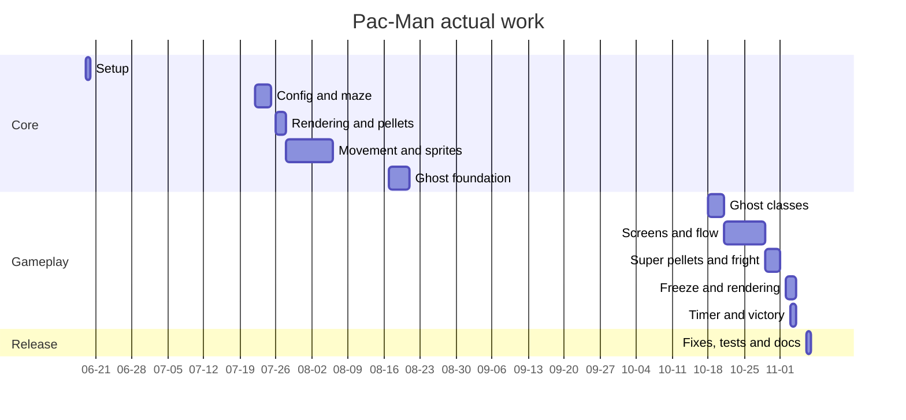

# Timeline

The project ran from 19 June to 6 November 2026. We did not keep a formal
Gantt while working. This timeline is reconstructed from the git history
and from the notes we kept in our shared task list. It shows when each
part actually moved, including the long gap in August and September.

## Actual phases

| Dates | Phase | What happened |
| --- | --- | --- |
| 19 Jun | Setup | Repository, Python environment, first README and dependency setup |
| 22 Jul | Configuration | Comment-aware JSON loader and the first config tests |
| 24 Jul | Maze loading | First `MazeGenerator` integration and a mypy cleanup |
| 26 Jul | Rendering | Wall bitmask rendering, pellet drawing and the first score tracking |
| 28 Jul | Actor skeleton | First Pac-Man and ghost classes |
| 4 Aug | Sprites | Pac-Man and ghost sprite sets, animated Pac-Man |
| 5 Aug | Movement | Wall collision, cell pinning, input buffering, pellet eating, ghost subclasses |
| 20 Aug | Ghost foundation | Position class, ghost base class and a sample interaction |
| 18 Oct | Ghost classes | asylla's ghost implementation, targets and linter fixes |
| 21 to 28 Oct | Screens and flow | State manager, theme, main menu, game screen, death and score flow |
| 29 to 31 Oct | Pellets and fright | Super-pacgums, frighten state, fright timer, collision fixes, first cheats |
| 2 Nov | Freeze and performance | Frozen ghost identity, render caching, frame clearing |
| 3 Nov | Timer and victory | Corner power pellets, level timer, victory screen, packaging workflow |
| 6 Nov | Final pass | Config `level` fix, instructions screen, tests, README and project management |
| 12 Nov | Published on itch.io | https://shadowthijs.itch.io/42-pacman |

## Gantt view of the actual work

## How the plan changed

The ghost classes were started in August, but the collision loop, fright
state and eaten-ghost behaviour were only connected to the game in
October. The main reasons were different course schedules and the fact
that the maze integration had to be stable before ghost movement could
be tested properly.

Packaging came together once the game was playable. That was useful
because it caught missing resources and a broken CI lint step before the
final week.

The last pass was mostly about things we had left for later: the config
`level` value was still ignored, the main menu had no instructions
screen, and the project management folder did not exist yet.

## Milestones

| Milestone | Date | Commit or evidence |
| --- | --- | --- |
| Repository created | 19 Jun | Initial setup |
| Config loader works | 22 Jul | `feat: config loading` |
| First maze rendered | 24 to 26 Jul | Maze parsing and rendering commits |
| Pac-Man moves and cannot cross walls | 5 Aug | Wall interaction and input buffering |
| Ghost classes exist | 5 to 20 Aug | Ghost subclass and base-class commits |
| Ghost interaction connected | 26 Oct | asylla's spawn and collision commits |
| Super-pacgums and fright | 29 to 31 Oct | Supergum and frighten commits |
| State stack and screens | 21 to 28 Oct | State manager and arcade screens |
| Cheats work | 31 Oct to 2 Nov | Konami, invincible, speed and freeze commits |
| Level timer and victory | 3 Nov | Corner power pellets, timer and victory screen |
| Package builds | 3 Nov | PyInstaller spec and CI workflow |
| Final cleanup | 6 Nov | Config level, instructions, tests and docs |

The repository has more than 80 commits. Most are under tlogtenb's
account and 15 are under asylla's account. Some of the ghost commits
under tlogtenb's account were pair-programming sessions with asylla.
