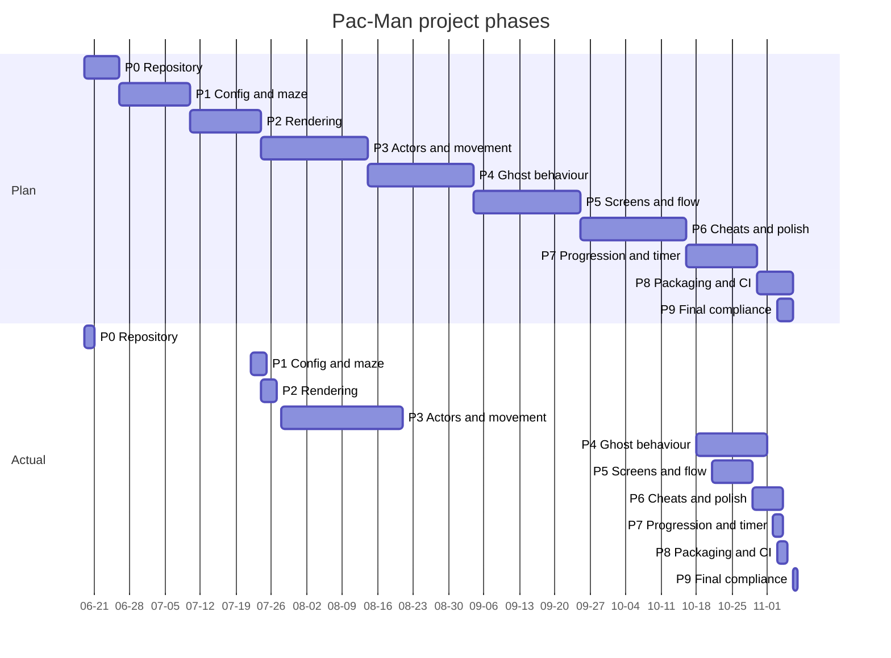

# Timeline

The project ran from 2026-06-19 to 2026-11-06. The plan was reviewed at
the end of each work week and adjusted. The dates below are reconstructed
from the git history and the shared task notes. They are deliberately
honest about the long gaps between phases, which were caused by other
coursework and by waiting for the maze generator package.

## Phase plan and actual dates

| Phase | Planned window | Actual window | Main outcome |
| --- | --- | --- | --- |
| P0. Repository and environment | 2026-06-19 to 2026-06-26 | 2026-06-19 | Python project, git repository, dependency setup, initial README |
| P1. Configuration and maze loading | 2026-06-26 to 2026-07-10 | 2026-07-22 to 2026-07-24 | Comment-aware JSON loader, safe defaults, first `MazeGenerator` integration |
| P2. Rendering and pellets | 2026-07-10 to 2026-07-24 | 2026-07-24 to 2026-07-26 | Wall bitmask rendering, pellet drawing, first score tracking |
| P3. Actors and movement | 2026-07-24 to 2026-08-14 | 2026-07-28 to 2026-08-20 | Pac-Man movement, buffered input, wall collision, ghost base classes, sprites |
| P4. Ghost behaviour | 2026-08-14 to 2026-09-04 | 2026-10-18 to 2026-10-31 | Per-ghost targets, collision loop, super-pacgums, frightened state |
| P5. Screens and game flow | 2026-09-04 to 2026-09-25 | 2026-10-21 to 2026-10-28 | State stack, main menu, game screen, death flow, highscore entry |
| P6. Cheats and polish | 2026-09-25 to 2026-10-16 | 2026-10-29 to 2026-11-03 | Konami unlock, invincibility, speed, freeze, extra lives, skip level |
| P7. Progression and timer | 2026-10-16 to 2026-10-30 | 2026-11-02 to 2026-11-03 | Level timer, corner power pellets, victory screen, HUD fixes |
| P8. Packaging and CI | 2026-10-30 to 2026-11-06 | 2026-11-03 to 2026-11-06 | PyInstaller recipe, multi-platform workflow, release artifacts |
| P9. Final compliance | 2026-11-03 to 2026-11-06 | 2026-11-06 | Config level fix, instructions screen, docs, tests, final lint |

## Gantt view

## Milestones

| Milestone | Date | Evidence |
| --- | --- | --- |
| Repository created | 2026-06-19 | Initial commit |
| Config loader working | 2026-07-22 | `feat: config loading` |
| First maze rendered | 2026-07-24 to 2026-07-26 | `feat: simple maze parsing`, `feat: better maze rendering + pacgums` |
| Pac-Man moves and collides | 2026-08-05 | `feat: wall interaction, cell pinning, input buffering` |
| Ghost subclasses created | 2026-08-05 to 2026-08-20 | Ghost class and subclass commits |
| Ghost interaction integrated | 2026-10-26 | asylla's ghost spawn and collision commits |
| Super-pacgums and fright | 2026-10-29 to 2026-10-31 | Supergum and frighten commits |
| State stack and screens | 2026-10-21 to 2026-10-28 | State manager and arcade screens |
| Cheat mode | 2026-10-31 to 2026-11-02 | Konami, invincible, freeze and speed commits |
| Level timer and victory | 2026-11-03 | `feat: corner power pellets, level timer and victory screen` |
| Packaging workflow | 2026-11-03 | CI workflow and spec commits |
| Final compliance pass | 2026-11-06 | Config level, instructions, docs and tests |

## What changed from the plan

- The ghost phase slipped because the A-Maze-Ing package had to
  be integrated first, and because the two students had different course
  schedules. The ghost foundation was started in August and the full
  behaviour was finished in October.
- The UI phase was brought forward once the state stack existed, because
  end-of-game flow depends on the score and highscore screens.
- Packaging was moved earlier than planned once the game was playable,
  so that CI could catch missing resources before the final week.
- The final compliance pass added the required Instructions screen,
  project management documents, tests and the config `level` fix.

## Time spent

The git history contains 83 commits. The project was
developed in evenings and weekends. The longest gaps are visible in
`progress_tracking.md` and are explained there. The final day was
reserved for compliance, documentation and verification.
